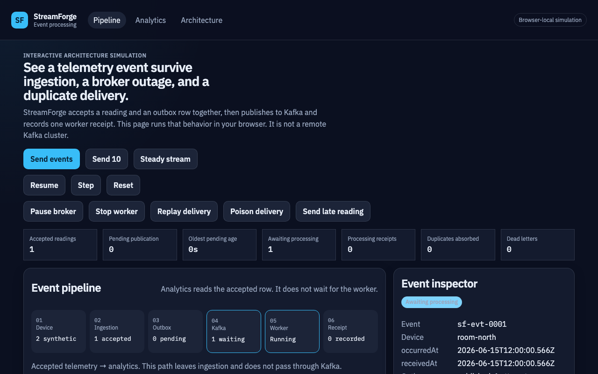
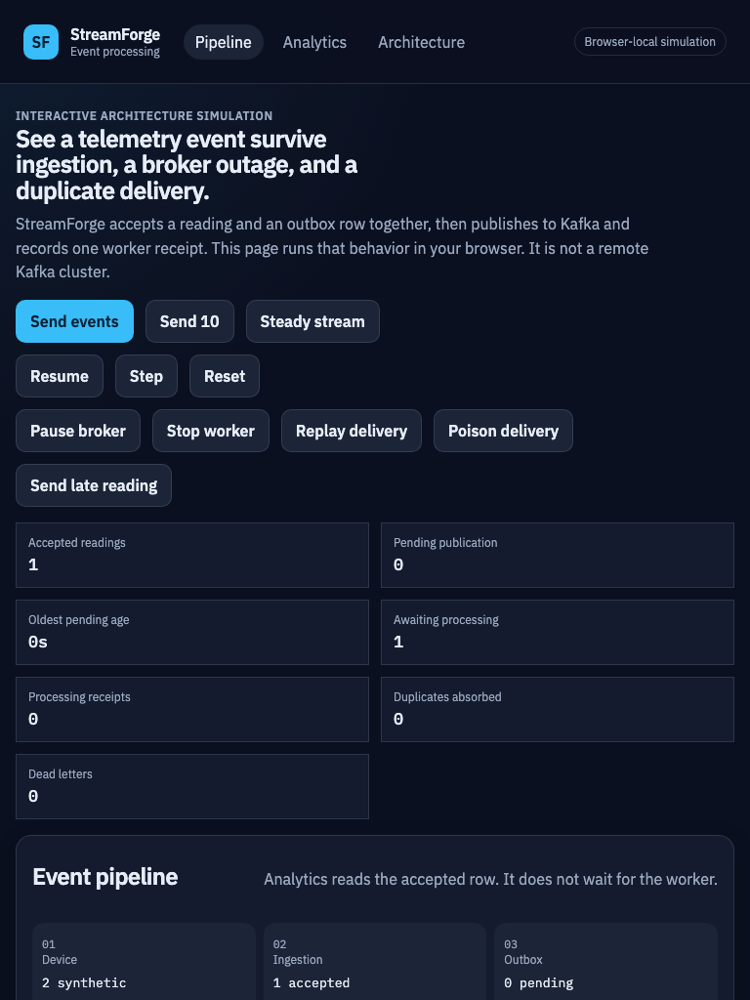
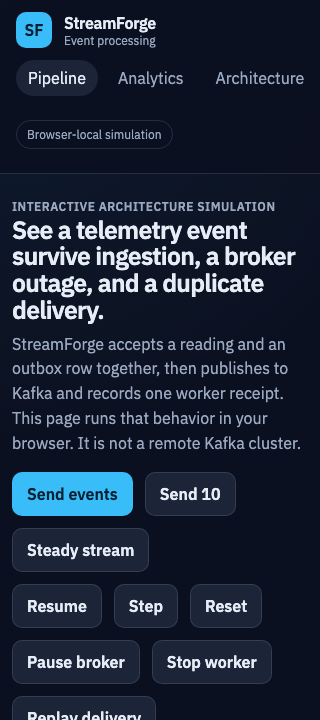
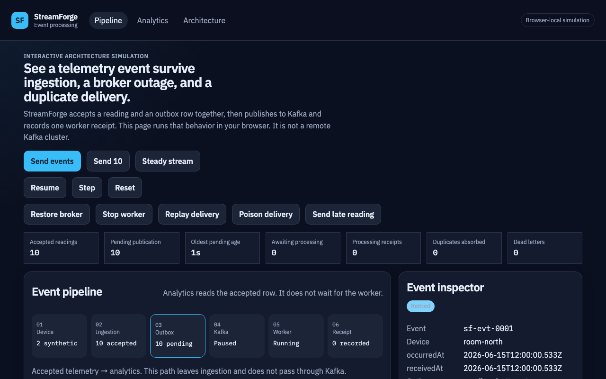
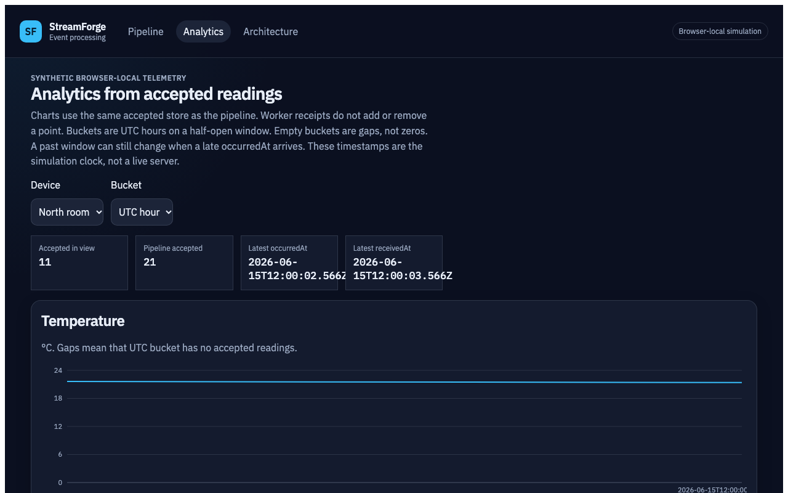

# StreamForge

StreamForge accepts device telemetry, stores it durably, and shows what happens when Kafka or the worker fails. The interesting part is the split between an accepted PostgreSQL row and the later Kafka publication and worker receipt.

An interviewer can open the public site and operate that pipeline in the browser. The Java API, PostgreSQL, Kafka, and worker remain in this repository and run locally with Docker. The website is a browser-local simulation of those behaviors. It is not a remote Kafka cluster, and this project does not deploy AWS infrastructure.

## Public site

The static site is intended for Vercel Hobby, with no server, database, or API key. The default project URL is assigned at deploy time. It is not recorded here until that deployment has been verified.

Refresh returns the simulation to a fixed UTC anchor, `2026-06-15T12:00:00Z`, plus elapsed simulation time. Moving between Pipeline, Analytics, and Architecture keeps the current run. Nothing is written to `localStorage`.

## What the Java system does

- A device reading and its outbox row commit in one PostgreSQL transaction.
- The same event id with the same payload is an idempotent retry. A different payload for that id is a conflict.
- The publisher claims one pending outbox row at a time, with a lease token so a stale publisher cannot finish the update.
- Kafka delivery is at-least-once. A crash after the broker acknowledgement can publish the record again.
- The worker writes one processing receipt per event id and acknowledges the Kafka record after that commit.
- A mismatched payload is poison. It is dead-lettered, and the source is acknowledged only after that dead-letter send succeeds.
- Analytics read `telemetry_events`. They do not wait for a receipt. UTC hour and day buckets can change when a late `occurredAt` arrives.
- The hourly rebuild is an explicit command and is off unless enabled.

The local broker is one Kafka 4.2.1 node, replication factor 1, one partition. That is not a highly available deployment.

## Stack

Java 21, Spring Boot 4.1.1, Spring JDBC, Spring Kafka, PostgreSQL 17, Kafka 4.2.1, Flyway V1–V5, React 19, TypeScript, Vite, Docker Compose, GitHub Actions.

## Screenshots

Browser-local simulation:











The local Docker console is separate and still requires the device-admin key. A screenshot of that console is included when one was captured without secrets: [local console](docs/portfolio/screenshots/live-console.png).

## Run the simulation locally

```bash
cd frontend
npm ci
npm run dev:showcase
```

Open `http://127.0.0.1:5173`. `npm run build` is the public static build. It does not call the API.

## Run the real stack

Use a disposable Compose project. Do not point `docker compose down -v` at the preserved `streamforge` volumes.

```bash
export JAVA_HOME="$(/usr/libexec/java_home -v 21)"
./mvnw -B -ntp verify
```

The preserved development database still has unpublished outbox rows. Leave `OUTBOX_PUBLISHER_ENABLED` false for that database. The disposable demo enables the publisher only on its own empty database. See [Development](docs/development.md).

```bash
docker compose -p streamforge-m7demo -f infra/compose.demo.yaml --env-file infra/.env.demo up -d --build
```

The live image is built with `npm run build:live`. Routes stay `/devices`, `/devices/:deviceId`, and `/devices/:deviceId/readings`. The key is typed into the page and kept in memory.

## Tests

```bash
./mvnw -B -ntp verify
cd frontend && npm run typecheck && npm run lint && npm test
cd frontend && npm run build && npm run check:public-bundle
cd frontend && npm run build:live && npm run check:live-bundle
cd frontend && npm run e2e:showcase
cd frontend && npm run e2e
```

`npm run e2e` is the existing Docker Playwright suite and needs the disposable stack. `npm run e2e:showcase` builds the public site and drives it with Playwright. It does not start Kafka.

GitHub Actions workflows: [backend](.github/workflows/backend-ci.yml), [frontend](.github/workflows/frontend-ci.yml), [demo](.github/workflows/demo-ci.yml). Remote results exist only after the owner pushes.

## Architecture

- [Real telemetry flow](docs/diagrams/telemetry-flow.md)
- [Outbox and worker](docs/diagrams/outbox-worker.md)
- [Analytics and rebuild](docs/diagrams/analytics.md)
- [Docker demo](docs/diagrams/docker-demo.md)
- [Simulation versus the Java stack](docs/diagrams/simulation-versus-backend.md)
- [Interview script and resume notes](docs/portfolio/README.md)

## Limits

- The public site simulates the pipeline. Counters on that site are not measured throughput.
- The demo broker is a single node.
- Publication is at-least-once, not exactly-once.
- The local console is not a public identity system.
- There is no AWS deployment.

## Repository

```text
backend/api          Spring Boot API, outbox publisher, analytics
backend/worker       Kafka consumer, receipts, dead letters
backend/simulator    HTTP telemetry CLI
frontend             Public simulation and the live operations console
infra                Local and disposable Compose
docs                 Decisions, milestones, diagrams, portfolio notes
```

Historical milestone notes stay in `docs/milestones/`. M1–M7 are owner-accepted. M8 is implemented locally and pending final acceptance.
