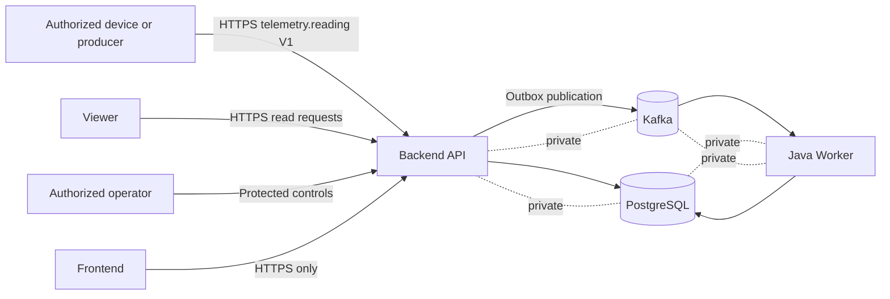
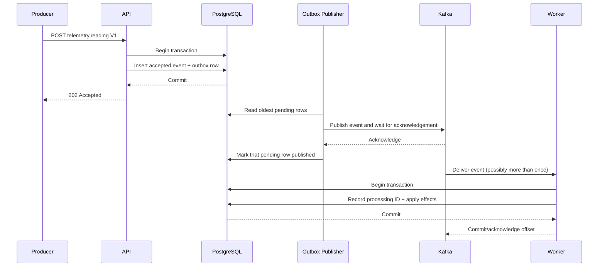

# StreamForge Architecture

## Scope and Status

This is the target architecture approved for progressive implementation after M1. M3 accepts telemetry and writes the outbox row. M4 adds a disabled-by-default publisher in the API, a single-node Kafka broker, and an independent Worker that records one processing receipt. Read models, replay, leases, and multi-publisher coordination remain later work. M4 is pending Final Check and is not a production deployment.

## Logical Components and Deployment Units

| Logical component | Responsibility | Initial deployment unit |
| --- | --- | --- |
| Ingestion API | Authenticate, authorize, validate, deduplicate, and durably accept events | Backend API |
| Query API | Serve device and telemetry read models | Backend API |
| Outbox publisher | Poll pending outbox rows and publish them to Kafka | Backend API. One enabled instance in M4. No separate relay process. |
| Telemetry processor | Consume events and insert one idempotent processing receipt | Worker |
| Read-model updater | Maintain queryable device and telemetry state | Later Worker work. M4 does not build an analytics read model. |
| Contract module | Shared event envelope/types without business coupling | Build-time library, not a process |
| Demo UI | Read-only visualization and authorized operational surfaces | Frontend |
| PostgreSQL | Transactional event acceptance, outbox, deduplication, and read state | Database |
| Kafka | Asynchronous event transport | Broker |

Logical rows in this table are design responsibilities, not microservices. Initially, the application has two independently runnable Java/Spring Boot deployment units: **API** and **Worker**. PostgreSQL and Kafka are infrastructure processes.

## Planned Repository Boundaries

```text
backend/api             API process and API-owned modules
backend/worker          Worker process and worker-owned modules
backend/shared-contract Minimal versioned event contract definitions
frontend                Later UI
infra                   Later local and approved deployment configuration
docs                    Engineering documentation and decisions
```

Directories are created only when they contain milestone deliverables. Sharing is restricted to stable contract types and utilities that do not erase module ownership.

## Context



Clients communicate with the API over HTTP(S), never directly with PostgreSQL or Kafka. The UI is also an API client. Kafka is the asynchronous boundary between acceptance/publication and processing.

## Event Data Flow



M4 runs this path when `OUTBOX_PUBLISHER_ENABLED=true` and the Worker is running. The publisher does not lock the row across the Kafka call. A second enabled API process can publish the same pending row. That restriction is intentional for M4.

## Transaction Boundaries

### Acceptance Transaction

The API will use one PostgreSQL transaction to:

1. establish uniqueness for `eventId`;
2. compare a retry against the canonical material payload;
3. store the accepted event and server-generated `receivedAt`; and
4. add the corresponding outbox row.

Only after commit may a new event be reported as durably accepted. HTTP `202` means the event and outbox row committed. It does not mean the event was published or processed. An identical retry returns HTTP `200` and keeps the original `receivedAt`. A different payload for the same event ID returns HTTP `409`. The acceptance transaction uses PostgreSQL's default READ COMMITTED isolation and the event primary key.

### Publication

The outbox publisher claims one committed pending row at a time. Publishing to Kafka and marking a row published cannot be one atomic transaction with standard PostgreSQL and Kafka operations. Publication is therefore retried and may produce duplicates. Correctness relies on a stable event ID and idempotent consumers, not on an exactly-once claim.

### Processing Transaction

The Worker validates the record, reconciles it with the stored telemetry row, and inserts `streamforge.processed_events` in one transaction. `INSERT ... ON CONFLICT (event_id) DO NOTHING` makes a duplicate delivery a no-op. The Kafka offset is acknowledged only after that transaction commits. A crash between commit and acknowledgement redelivers the record and does not insert a second receipt. This is not exactly-once Kafka delivery.

The topic key is `deviceId`. Each M4 topic has one partition, so local consumption is ordered for the whole topic. That does not remove hot-key risk if the partition count later increases.

## Transactional Outbox

The outbox prevents the API from having to atomically commit to PostgreSQL and Kafka:

- If the acceptance transaction rolls back, neither accepted event nor outbox row exists.
- If Kafka is unavailable after acceptance, the committed outbox row remains retryable.
- If publication succeeds but recording publication fails, the publisher may send the same event again.
- If the publisher crashes after claiming a row and before Kafka accepts it, the lease expires and another publisher can reclaim the row.
- If the publisher crashes after Kafka accepts the record and before the fenced published update, the next owner can send the record again.
- Transient publication failures stay `pending` and become due at `next_attempt_at`. They are not marked `failed` because a retry count was reached.
- A non-retryable encoding defect can be marked `failed`. The telemetry and outbox rows remain. Requeue is an operator SQL statement, not an HTTP route.
- Two enabled publishers claim different eligible rows. A stale claim token cannot update a newer claim. An expired lease can still overlap a send already in flight.

The publisher polls about once a second. Each cycle claims one row, finishes that attempt, and then claims the next, up to 20 rows. It uses producer `acks=all` and updates `published_at` only after the broker acknowledges and the claim token still matches. Kafka producer idempotence does not remove duplicates across a process restart.

## Failure Scenarios

| Scenario | Expected behavior |
| --- | --- |
| API fails before database commit | Request is not accepted; retry is safe. |
| API loses connection after commit but before response | Client may retry; event ID deduplication returns the existing acceptance without duplicate effects. |
| Kafka unavailable | API may continue accepting within database/capacity policy; outbox backlog grows visibly. |
| Publisher sends then crashes before marking published | Event may be republished; Worker idempotency protects effects. |
| Worker fails before database commit | Kafka redelivers; no partial committed effect should remain. |
| Worker commits then fails before offset acknowledgement | Kafka redelivers; processing ID makes effects a no-op. |
| Invalid or poison event reaches Worker | Publish the original record to `telemetry.reading.v1.dlt` and acknowledge the source only after Kafka accepts the dead-letter record. A failed dead-letter send leaves the source unacknowledged. |
| PostgreSQL unavailable | Durable acceptance and processing are unavailable; API must not return false acceptance. |

Backpressure thresholds, admission behavior during prolonged Kafka outages, and recovery objectives are unresolved.

## Communication and Security Boundaries

- External writes and controls enter through authenticated API routes.
- Public access, if enabled, is limited to deliberately selected read-only routes.
- Authorization decisions are server-side; UI visibility is not a security control.
- PostgreSQL and Kafka use private network exposure only.
- Service credentials, TLS, network policy, audit logging, and identity integration are designed before deployment.
- Event payloads must not be assumed trustworthy merely because they came through Kafka.

## Data and Time Semantics

PostgreSQL is the primary operational and initial analytics database. S3/Parquet is reconsidered in M6 based on actual historical storage and analytical requirements rather than assumed now. `occurredAt` is producer event time; `receivedAt` and `processedAt` are server-controlled lifecycle times. Late and out-of-order data must remain distinguishable from processing delay. See the [Event Contract](event-contract.md).

## Deployment Assumptions

Local Kafka is Apache Kafka 4.2.1 in single-node KRaft mode. Replication factor is 1. Broker disk loss, retention expiry, and an unrecoverable single-node volume can drop records that PostgreSQL and the Worker have not both retained. A Kafka acknowledgement does not mean the Worker has committed a receipt. AWS remains a later decision, pending M9 review and explicit approval.

## Observability

The publisher logs claims, publication, retry, and permanent failure with the event ID and a short error code. About once a minute it logs pending, eligible, claim, and failed counts. The Worker logs receipt creation, duplicate delivery, and dead-letter handling. Those logs do not include API keys or database passwords. Dashboards and alert products are not part of M5.

## Deferred Details

M5 adds single-row leases, fenced publication, and transient retry. Still open: receipt retention, replay, read models, SLOs, identity beyond two static keys, and deployment topology. They are tracked in [Known Issues and Risks](known-issues.md).

## Decisions

The binding decision set is recorded in [ADR-01](decisions/ADR-01.md) through [ADR-11](decisions/ADR-11.md).

