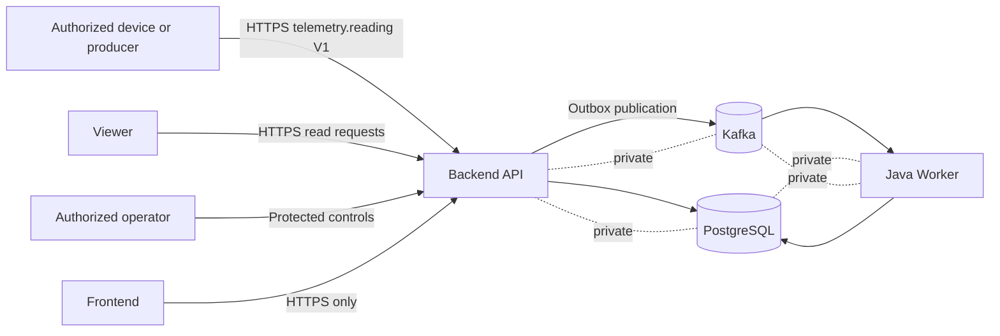
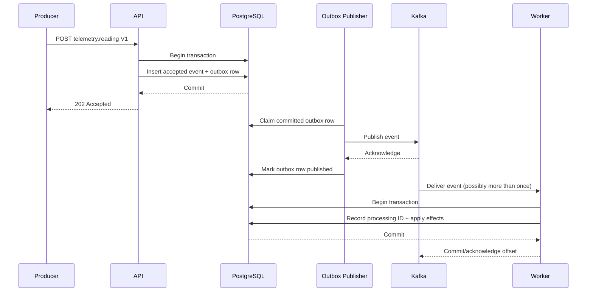

# StreamForge Architecture

## Scope and Status

This is the target architecture approved for progressive implementation after M1. M3 implements device registration and durable telemetry acceptance, including the outbox insert, on the API. The outbox publisher, Kafka, and Worker in the diagrams below are still target behavior, not running processes.

## Logical Components and Deployment Units

| Logical component | Responsibility | Initial deployment unit |
| --- | --- | --- |
| Ingestion API | Authenticate, authorize, validate, deduplicate, and durably accept events | Backend API |
| Query API | Serve device and telemetry read models | Backend API |
| Outbox publisher | Claim committed outbox rows and publish them to Kafka | Backend API initially; ownership may be refined in M3 |
| Telemetry processor | Consume events and apply idempotent business effects | Worker |
| Read-model updater | Maintain queryable device and telemetry state | Worker |
| Contract module | Shared event envelope/types without business coupling | Build-time library, not a process |
| Demo UI | Read-only visualization and authorized operational surfaces | Frontend |
| PostgreSQL | Transactional event acceptance, outbox, deduplication, and read state | Database |
| Kafka | Asynchronous event transport | Broker |

Logical rows in this table are design responsibilities, not microservices. Initially, the application has two independently runnable Java/Spring Boot deployment units: **API** and **Worker**. PostgreSQL and Kafka are infrastructure processes.

## Planned Repository Boundaries

```text
backend/api             API process and API-owned modules
backend/worker          Worker process and worker-owned modules
backend/shared-contract Minimal versioned event contract definitions
frontend                Later UI
infra                   Later local and approved deployment configuration
docs                    Engineering documentation and decisions
```

Directories are created only when they contain milestone deliverables. Sharing is restricted to stable contract types and utilities that do not erase module ownership.

## Context



Clients communicate with the API over HTTP(S), never directly with PostgreSQL or Kafka. The UI is also an API client. Kafka is the asynchronous boundary between acceptance/publication and processing.

## Event Data Flow



M3 implements the acceptance transaction through the HTTP response. Publisher claiming, Kafka acknowledgement, and Worker processing remain later work.

## Transaction Boundaries

### Acceptance Transaction

The API will use one PostgreSQL transaction to:

1. establish uniqueness for `eventId`;
2. compare a retry against the canonical material payload;
3. store the accepted event and server-generated `receivedAt`; and
4. add the corresponding outbox row.

Only after commit may a new event be reported as durably accepted. HTTP `202` means the event and outbox row committed. It does not mean the event was published or processed. An identical retry returns HTTP `200` and keeps the original `receivedAt`. A different payload for the same event ID returns HTTP `409`. The acceptance transaction uses PostgreSQL's default READ COMMITTED isolation and the event primary key.

### Publication

The outbox publisher reads only committed rows. Publishing to Kafka and marking a row published cannot be one atomic transaction with standard PostgreSQL and Kafka operations. Publication is therefore retried and may produce duplicates. Correctness relies on a stable event ID and idempotent consumers, not on an exactly-once claim.

### Processing Transaction

The Worker will combine its deduplication record and business/read-model mutations in one PostgreSQL transaction where feasible. The Kafka offset is acknowledged only after successful commit. A crash between database commit and offset acknowledgement causes redelivery; the existing processing record must turn that redelivery into a no-op for business effects.

Partitioning keys and ordering guarantees are not yet approved. Device ID is a candidate key because it may preserve per-device order, but M3 must validate hot-key and ordering requirements.

## Transactional Outbox

The outbox prevents the API from having to atomically commit to PostgreSQL and Kafka:

- If the acceptance transaction rolls back, neither accepted event nor outbox row exists.
- If Kafka is unavailable after acceptance, the committed outbox row remains retryable.
- If publication succeeds but recording publication fails, the publisher may send the same event again.
- If the publisher crashes while handling a row, a lease/claim timeout or equivalent mechanism must make it retryable.
- If an event is permanently unpublishable, it must become visible to operators rather than retry forever silently.
- If multiple publisher instances race, row claiming and stable identifiers must avoid loss; duplicates remain possible and safe.

Planned controls include bounded retry/backoff, claim recovery, publication attempt metadata, lag/failure metrics, and an authorized recovery path. Exact schema, polling/notification mechanism, retention, and dead-letter policy remain deferred to M3/M4.

## Failure Scenarios

| Scenario | Expected behavior |
| --- | --- |
| API fails before database commit | Request is not accepted; retry is safe. |
| API loses connection after commit but before response | Client may retry; event ID deduplication returns the existing acceptance without duplicate effects. |
| Kafka unavailable | API may continue accepting within database/capacity policy; outbox backlog grows visibly. |
| Publisher sends then crashes before marking published | Event may be republished; Worker idempotency protects effects. |
| Worker fails before database commit | Kafka redelivers; no partial committed effect should remain. |
| Worker commits then fails before offset acknowledgement | Kafka redelivers; processing ID makes effects a no-op. |
| Invalid or poison event reaches Worker | Do not silently discard; retry/dead-letter and operator policy is finalized later. |
| PostgreSQL unavailable | Durable acceptance and processing are unavailable; API must not return false acceptance. |

Backpressure thresholds, admission behavior during prolonged Kafka outages, and recovery objectives are unresolved.

## Communication and Security Boundaries

- External writes and controls enter through authenticated API routes.
- Public access, if enabled, is limited to deliberately selected read-only routes.
- Authorization decisions are server-side; UI visibility is not a security control.
- PostgreSQL and Kafka use private network exposure only.
- Service credentials, TLS, network policy, audit logging, and identity integration are designed before deployment.
- Event payloads must not be assumed trustworthy merely because they came through Kafka.

## Data and Time Semantics

PostgreSQL is the primary operational and initial analytics database. S3/Parquet is reconsidered in M6 based on actual historical storage and analytical requirements rather than assumed now. `occurredAt` is producer event time; `receivedAt` and `processedAt` are server-controlled lifecycle times. Late and out-of-order data must remain distinguishable from processing delay. See the [Event Contract](event-contract.md).

## Deployment Assumptions

Local Kafka is planned as single-node KRaft through Docker Compose in M4. This is suitable for development and failure exercises but provides no broker high availability. AWS is the eventual target; EC2 plus Docker Compose is a preferred candidate only, pending M9 cost, security, backup, resource, and operations evaluation and explicit deployment approval.

## Observability

Planned telemetry includes structured logs with event IDs, API and Worker health, acceptance/publication/processing counters, outbox age and backlog, consumer lag, retries, conflicts, and processing failures. Metric names, tooling, alert thresholds, and retention are not yet selected.

## Deferred Details

Open items include API shape, canonical payload comparison, database schemas, isolation/locking, event retention, Kafka topics and partitions, keying, schema compatibility enforcement, retries and dead-letter handling, replay semantics, authentication/authorization technology, read models, SLOs, and deployment topology. They are tracked in [Known Issues and Risks](known-issues.md).

## Decisions

The binding decision set is recorded in [ADR-01](decisions/ADR-01.md) through [ADR-10](decisions/ADR-10.md).

