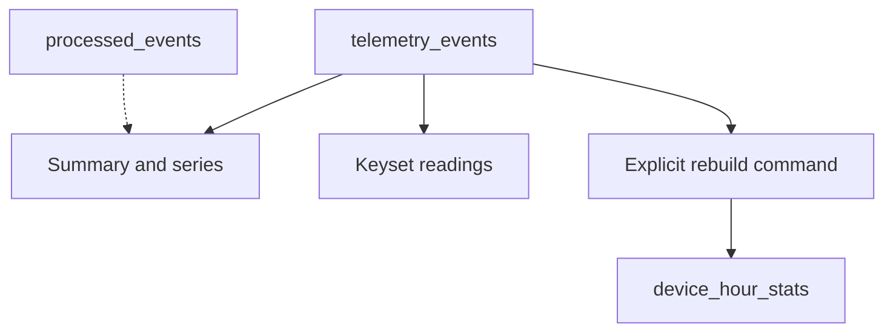

# Analytics and the hourly rebuild

The API does not read `device_hour_stats` or receipts. The rebuild is off unless `STREAMFORGE_ANALYTICS_REBUILD_ENABLED=true`. A late `occurredAt` changes the UTC bucket of the accepted row. Past windows are not finalized.
