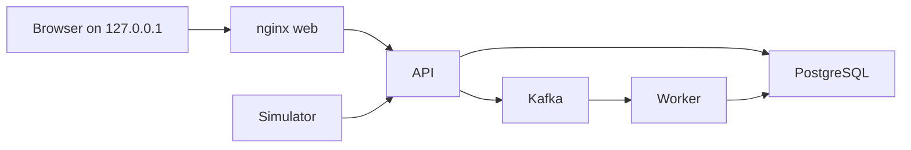

# Disposable Docker demo

`infra/compose.demo.yaml` publishes the web and API on loopback only. PostgreSQL and Kafka publish no host ports. The web image is the live build, with `/devices` routes and an in-memory device-admin key.
